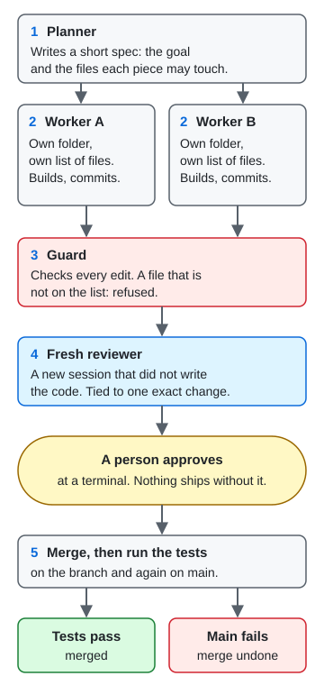
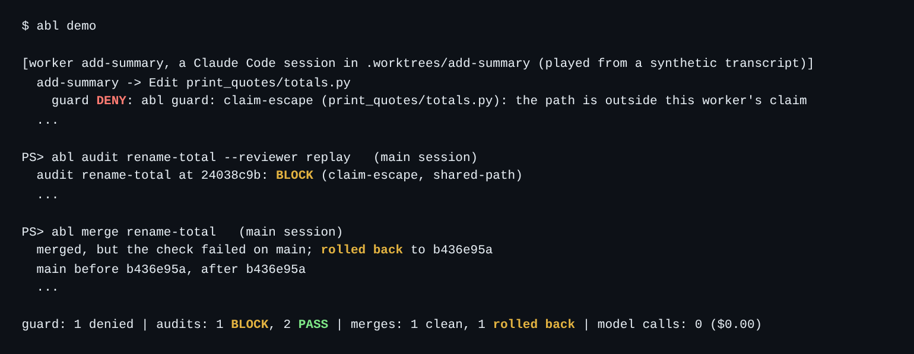

# agent-build-loop

Several Claude Code sessions working on one project overwrite each other's files, and nobody checks what they wrote. `abl` lets one person run a team of workers on one repository safely, with five rules:

1. A planner writes a short spec: the goal and the files each piece of work may touch.
2. Each worker gets its own copy of the code and a list of files it may change.
3. A guard refuses any edit outside that list.
4. A fresh reviewer, a session that did not write the code, checks the change.
5. The merge is undone if the tests break, and a person approves what ships.

New here? Read [Running a team of Claude agents safely](docs/explainer.md): plain English, no git knowledge needed. Standard library only, no model call, no key, $0.



```
guard: 1 denied | audits: 1 BLOCK, 2 PASS | merges: 1 clean, 1 rolled back | model calls: 0 ($0.00)
```
That is the last line of `abl demo`, in words: the guard stopped 1 edit, the reviewer blocked 1 change and passed 2, 1 merge went through, and 1 merge broke the tests and was undone automatically. It plays two fictional workers (client *Kestrel Print Co.*) and makes no model call.



## 30-second quickstart
```
python3 -m venv .venv
.venv/bin/pip install --require-hashes -r requirements-dev.lock && .venv/bin/pip install --no-deps --no-build-isolation .
.venv/bin/abl demo
```
Windows: use `.venv\Scripts\`. Needs Python 3.11+ and git 2.30+. `abl` is this package's command; `abl demo` builds a throwaway repository and plays the workers from **synthetic, hand-written transcripts**; the reviewer is a stub or a replay. Your own repository: [docs/usage.md](docs/usage.md).

## The words
- **Main session:** the one Claude Code session (with the person) that plans work, audits and merges. The planner of rule 1.
- **Worker:** a separate Claude Code session that builds one piece in its own git worktree (its own folder and branch).
- **Claim:** the list of paths one worker may change. Two open claims never overlap.
- **Guard:** the hook that checks each edit against the claim before it happens.
- **Audit:** the check of one commit by fixed rules plus a fresh reviewer. Verdicts: PASS, PASS-WITH-NOTES or BLOCK.
- **Rolled back:** a merge that made the project's tests fail on `main` is reversed.

## How it works
```
person -> main session --abl new--> worktree + claim per worker
          worker (Claude Code) behind the guard hook -> commits on its own branch
          abl audit: fresh-context reviewer, bound to one commit
          abl approve: the person types the commit id at a terminal
          abl merge: check on the branch, merge, check on main; fails on main -> automatic rollback
          abl handover: state for the next session
```
- **Guard hook:** Edit and Write are checked by resolved path against the claim; shell commands are parsed on a best-effort basis; a hook that cannot decide denies.
- **Audit:** deterministic checks (claim, secret-shaped lines, config tampering) plus a reviewer. Verdicts: PASS, PASS-WITH-NOTES (merge allowed, findings listed) or BLOCK (merge refused). A verdict belongs to one commit; a later commit makes it stale.
- **Approval and merge:** `abl approve` needs a terminal and a retyped commit id; the merge needs a current pass and runs the project's `check` on the branch and again on `main`.
- **Rollback:** if `main` fails after a merge, `git reset --keep` undoes it.

## Result
Both sets run in temporary repositories with a stub reviewer. Numbers are quoted from [`evals/results/eval.md`](evals/results/eval.md), written by `abl eval`.

red-team set: 60 / 60 matched (n = 65: 60 scored, 5 known misses, 0 skipped)
merge set: 10 / 10 matched (n = 10: 10 scored, 0 skipped)

**Honest results line:** 60 / 60 counts only the cases the guard handles today. Five known misses stay in the set so the gap stays visible:
- `gap-python-c-writes-a-file`: `python -c` writing a file
- `gap-script-the-worker-wrote`: a script the worker wrote, then runs
- `gap-shell-write-other-worktree`: a shell write into another worktree
- `gap-shell-write-outside-repo`: a shell write outside the repo
- `gap-mcp-write-when-allowed`: an MCP write tool when `deny_mcp_for_workers = false`

## Security
- Blocks edits outside the claim, into another worktree, the main checkout, the git directory and the settings files. Paths are resolved first, including Windows tricks (junctions, 8.3 short names, NTFS streams).
- Denies git commands that move branches or push, and person-only commands run by a Claude session.
- Reads its configuration from the main branch plus a trust fingerprint (a hash of git config, attributes and hooks); a planted hook blocks audit, approve and merge.
- It is a guard, not a sandbox. Report a problem as in [SECURITY.md](SECURITY.md).

## Honest limits
- The guard is a **guard, not a sandbox**: a worker can still write through a script or `python -c` (the known misses above).
- It defends against mistakes and prompt-injected drift, not a hostile local user; that needs containers or separate OS users.
- The reviewer here is a stub or a replay of synthetic transcripts; no model call is made anywhere.
- The merge gate is only as good as your `check` command. Person-only commands need a real terminal; in Git Bash use `winpty abl approve <topic>` (details in usage).

Platforms: Core modules tested on Linux; hook, merge gate and demo tested on Windows 11 (PowerShell 5.1 and Git Bash). Not tested on macOS.

## More
**Start here:** [Running a team of Claude agents safely](docs/explainer.md). **Why this exists:** [how I direct Claude Code agents](docs/build-loop.md) (the method behind this tool). [Usage and full limits](docs/usage.md) · [Brief](docs/brief.md) · [Pilot readout](docs/pilot-readout.md) · [Decisions](docs/decisions.md) · [License](LICENSE)

Designed, specified and reviewed by me; most code written by Claude Code agents I directed.
