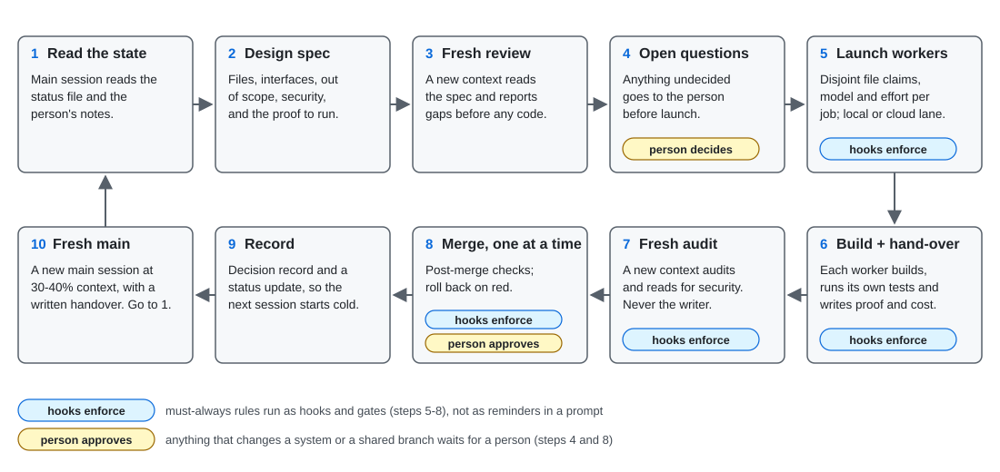

# How this was built: a loop for directing Claude Code agents

I design, specify and review. Claude Code agents write most of the code. This page is the working method, in generic terms,
and how I would run it at a customer. The diagram is [`img/build-loop.svg`](img/build-loop.svg).
New to this? The [plain-English explainer](explainer.md) covers the five rules the tool enforces; this page is the longer method behind them.

## Why a loop at all
One long chat with one agent gets worse as it fills: it forgets earlier decisions, grades its own work kindly, and
slowly rewrites things nobody asked about. Several agents at once make that worse unless the work is cut into pieces that
cannot collide. The loop is the smallest structure I found that keeps quality up while the amount of work goes up.

## The loop
1. **Read the state.** A main session reads the status file and my notes.
2. **Write a design spec** for one piece of work: the files it may touch, the interfaces, what is out of scope, the security
   considerations and the exact check that proves it works.
3. **A fresh-context review of the spec.** A new session, with none of the author's assumptions, reads it and reports gaps.
4. **Open questions go to me** before anything is built. Decisions are mine; the agents propose.
5. **Launch workers** with disjoint file claims (two workers never own the same file), a model and effort chosen per job, on a local lane (needs my machine) or a cloud lane (a sandbox).
6. **Each worker builds**, runs its own tests and writes a hand-over note: what changed, the proof lines, the cost.
7. **A fresh audit and a security review**, by a session that did not write the code.
8. **Merge one branch at a time.** Post-merge checks run; on red, roll back.
9. **Record** the decision and update the status file.
10. **Start a fresh main session** at about 30-40% context, with a written handover. Back to 1.

## Specs are contracts
A spec names files, interfaces and a proof command, and says what is *not* in scope. A worker that cannot name its proof is not ready to start.
An edit outside the claimed files is blocked by a hook, so scope creep shows up as an error, not as a surprise in review.

## The writer never grades its own work
The agent that wrote the code is the worst reviewer of it. Audits and security reviews run in a fresh context and report only
correctness, security and requirement gaps; style opinions are optional. Tests are part of the work, but a green suite from
the writer is a claim, not a result.

## Context is the scarce resource
Quality drops as the window fills. I keep investigations narrow, send wide searches to a subagent so the files stay out of the main
context, give each worker one topic, and hand over to a fresh session early. After two failed fixes on one problem I stop,
write down what was learned and restart with a better prompt.

## Rules become gates and hooks
A sentence in a prompt gets ignored eventually. Anything that must hold every time is a hook or a gate: file claims enforced on
every edit, a publish step that scans every commit and file before anything leaves my machine, a merge that needs a fresh passing audit
for the exact commit. The prompt file stays short.

## Cost discipline
Model and effort are chosen per job, not defaulted. The one live evaluation in this repo ran under a hard `--budget`, started
with a 3-alert pilot that projected the full cost, and cost $1.44 of a $4.00 cap. Everything shipped replays the recording at $0.

## Three lessons
1. **When a model balks, fix the design, not the wording.** Writing realistic attack data triggered safety stops four times.
   Rewording did not help. I changed what the data *is*: abstract alert cards, one trigger event plus neutral context, no payloads. The
   set got smaller (one malicious alert) and the README says so plainly.
2. **Fresh reviewers find what green tests miss.** Audits caught a results table that lacked its own limit line and an
   error path that would have thrown away a 30-alert run on one API failure. Both were small and both were real.
3. **Make the honest number the easy number.** The result table carries the baseline, `n_malicious`, the failures and the known
   misses of the checker. Putting the limits next to the headline made them cheap to state and hard to skip.

## How I would run this at a customer
1. **Discovery first.** Who does the work today, what does a good result look like, what must never be automated.
2. **Expected results before code.** A small answer key written with the customer's people, plus a trivial baseline to beat.
3. **A read-only pilot** on an export of their data, with a hard spend cap and every run recorded.
4. **Review steps built in:** a checker for what can be checked in code, and a person for the rest.
5. **Handover:** a one-page readout with the numbers, the failures, a short list of decisions, and a runbook their team can run without me.

## The larger system
I use the same loop on a larger private multi-tenant investigation console; happy to walk through it.
