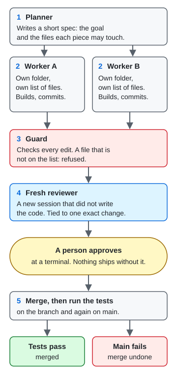

# Running a team of Claude agents safely

You have used a chat assistant. You know one chat can write code. This page explains what goes wrong when you ask several
Claude sessions to build one project together, and the five rules `abl` uses to prevent it. No git knowledge needed.

Think of a **building site**. You are the owner. One **site manager** plans the work. Several **crew members** build,
each in their own bay. An **inspector** checks the finished work before it joins the building.

## The problem
- **One session gets slow and confused on big work.** The longer a chat runs, the more it forgets, and it grades its own work kindly.
- **Several sessions at once step on each other.** Two crew members rebuild the same wall; one overwrites the other.
- **Nobody checks the work.** The crew member who built it says it is fine.

## The five rules
1. **The site manager writes a short spec.** Before anyone builds, one session writes down the goal and the exact files a
   piece of work may touch. In `abl` this is `abl new <topic> --owns <files> --goal "..."`
   ([`worktrees.py`](../src/agent_build_loop/worktrees.py); proof: `test_new_list_claim_add_end` in [`test_worktrees.py`](../tests/test_worktrees.py)).
2. **Each crew member gets their own bay and a list of files.** Each worker gets its own copy of the code (a git *worktree*: a
   separate folder on its own branch) and a *claim*, the list of files it may change. Two open claims never overlap
   ([`claims.py`](../src/agent_build_loop/claims.py); proof: `test_overlap_with_another_open_claim` in [`test_claims.py`](../tests/test_claims.py)).
3. **A guard stops edits outside the list.** A small program checks every edit before it happens. If a worker reaches for a file
   it does not own, the edit is refused ([`guard.py`](../src/agent_build_loop/hooks/guard.py); proof:
   `test_worker_claim_escape_shared_other_main_outside` in [`test_guard.py`](../tests/test_guard.py)).
4. **A fresh inspector checks the work.** The reviewer is a new session that did not write the code. It is tied to one exact
   change: if the worker changes anything afterwards, the verdict no longer counts
   ([`audit/run.py`](../src/agent_build_loop/audit/run.py); proof: `test_a_commit_after_the_audit_makes_the_verdict_stale` in [`test_audit.py`](../tests/test_audit.py)).
5. **If the tests break, the merge is undone, and a person approves.** Joining the work into the main building runs the
   project's own tests first. If the main building fails them, the merge is reversed automatically. A person types the
   change's id at a terminal to approve ([`merge.py`](../src/agent_build_loop/merge.py); proof:
   `test_main_check_failure_rolls_back_and_keeps_untracked_files` in [`test_merge.py`](../tests/test_merge.py)).

## What the demo shows
`abl demo` plays two made-up workers (client *Kestrel Print Co.*) from hand-written transcripts. No model is called, so it costs $0.
Its last line reads: *the guard stopped 1 edit, the reviewer blocked 1 change, 1 merge went through, 1 merge was undone.*

| Step in the demo | Rule |
|---|---|
| Two workers are opened, each with its own files | 1 and 2 |
| One worker tries to edit a file it does not own; the guard refuses | 3 |
| The reviewer passes one change and blocks the other (it touched a shared file) | 4 |
| The person approves; the first change merges | 5 |
| The second change merges, breaks the tests on main, and is undone | 5 |

## What it does not do
- It does **not make the model smarter.** It limits the damage a mistake can do and makes each mistake visible.
- It is a **guard, not a sandbox.** A worker can still write a file through a script. The demo shows this too, and five such gaps are listed in the [README](../README.md#result).
- The person still decides. Nothing merges without a person's approval.

Next: [the quickstart and the five rules in short](../README.md), [how I direct the agents](build-loop.md), [usage on your own repository](usage.md).
